# scroll-painting-animation

把一幅长卷名画（或任何"沿一条路看过去"的全景题材）做成**横向卷轴、等距游戏画风**的动画短片。

这是一个 **Agent Skill**（给 Kiro / Claude 这类编码智能体用的方法论 + 工具包），不是一个开箱即跑的渲染器。
它把一次完整的实战经验固化成：一条九步流程、每步的验收门槛、一套可复用的 Python 库（`scrollkit`）、
一个可运行的最小骨架（`scroll_demo`），以及素材生产、音效、抽帧验收的工具脚本。

来源项目：《清明上河图》180 秒 1080p 等距动画，以及后续的《紫禁城》长卷。

---

## 成片预览

### 《清明上河图》180s · 1080p

镜头匀速横移，昼 → 夜 → 黎明 → 晨首尾呼应；行人车马船在等距场景上走动，题诗逐字晕墨显现。

**在线互动版 → <https://xiwan.github.io/qingming-scroll/>**（上下滑动 = 左右展卷，见[关联项目](#关联项目)）

| | |
|---|---|
| 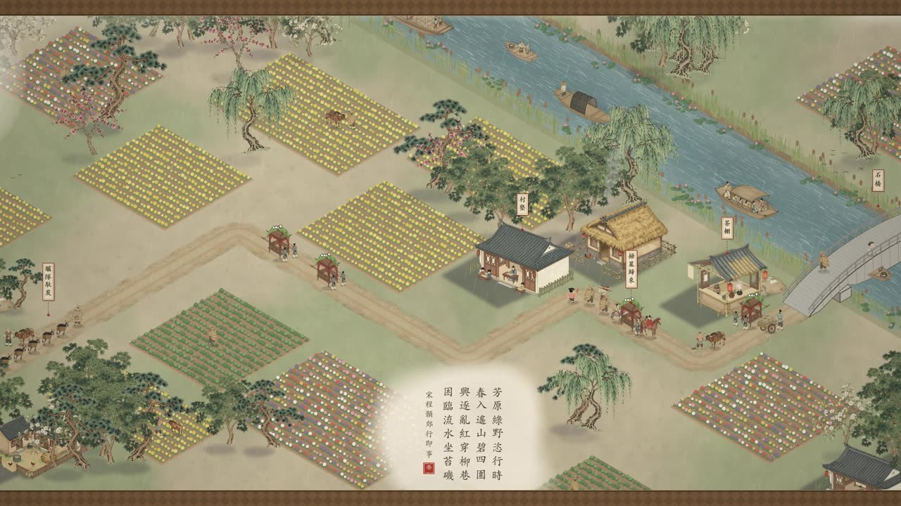 <br> **城郊**：田垄、柳岸、驴队，题诗竖排右起、雾衬托底 |  <br> **虹桥（高潮段）**：漕船过弯、桥上围观、桅杆 |
| 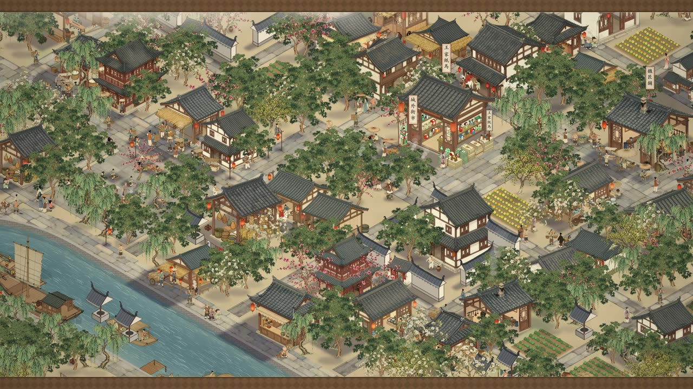 <br> **城内街市**：同业相聚的功能团，密度随城乡梯度上升 | 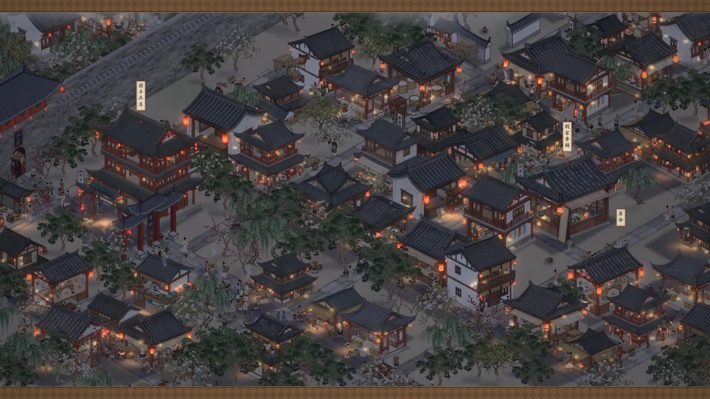 <br> **入夜**：灯笼按连通块形状筛选，灯火多少随功能团 |
| 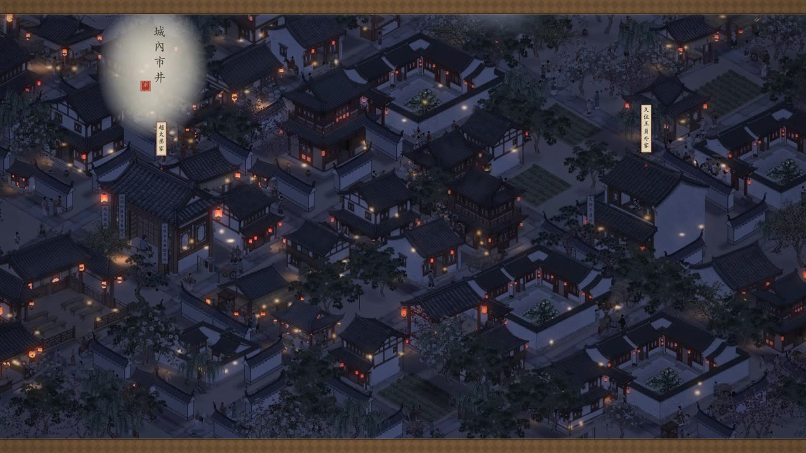 <br> **深夜**：夜色只染画里的景物，题诗衬雾不压暗 | 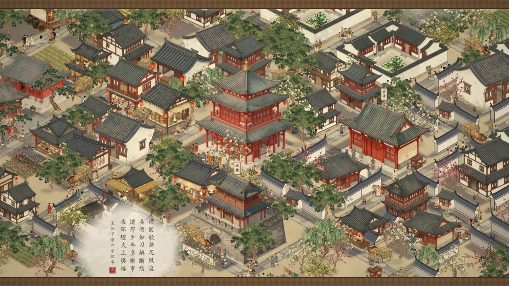 <br> **黎明**：酒楼与官署，色温回暖，与开场呼应 |

### 《紫禁城》· 等距长卷

同一套引擎换题材：建筑平面与高度取自 OpenStreetMap，中轴线上的大朝会按"距离 → 动作"脚本编排。

| | |
|---|---|
| 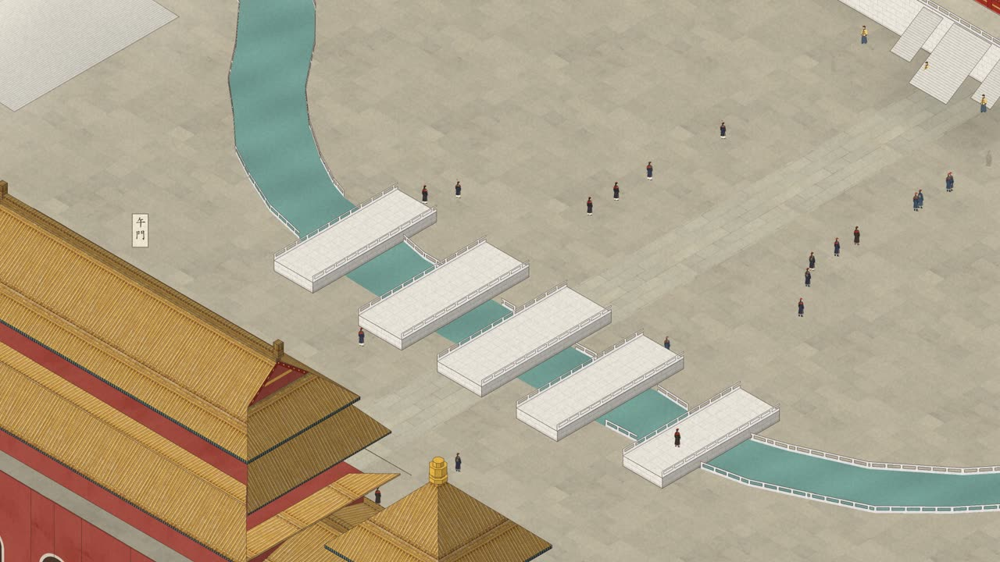 <br> **午门 · 内金水桥** | 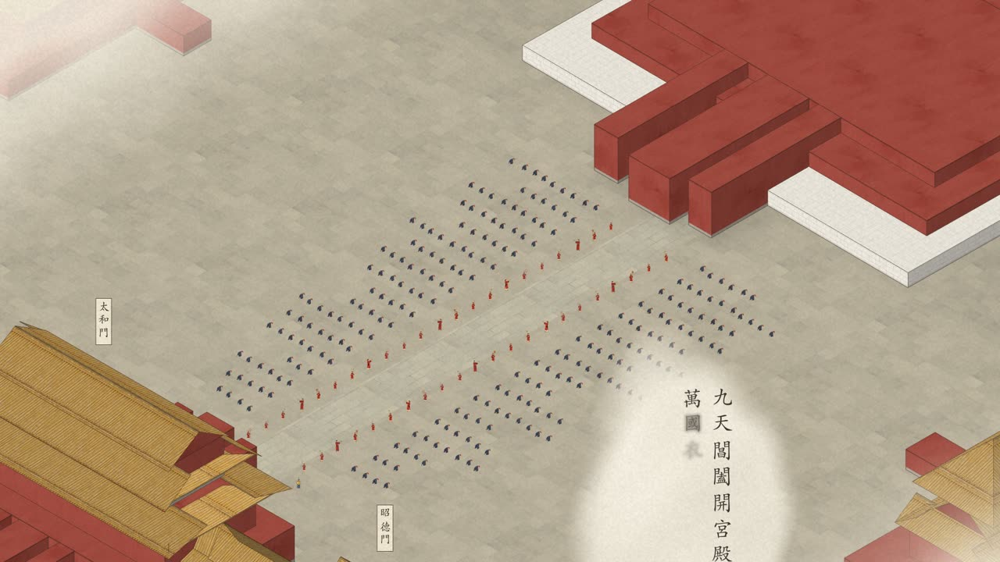 <br> **太和门广场**：百官列班，题诗渐显 |
| 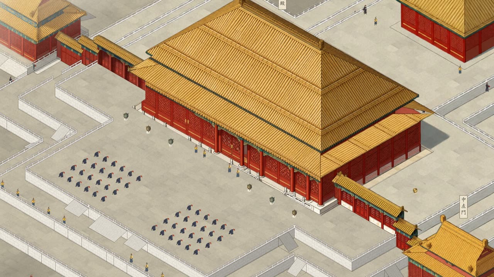 <br> **太和殿**：重檐庑殿、丹陛、铜鼎 | 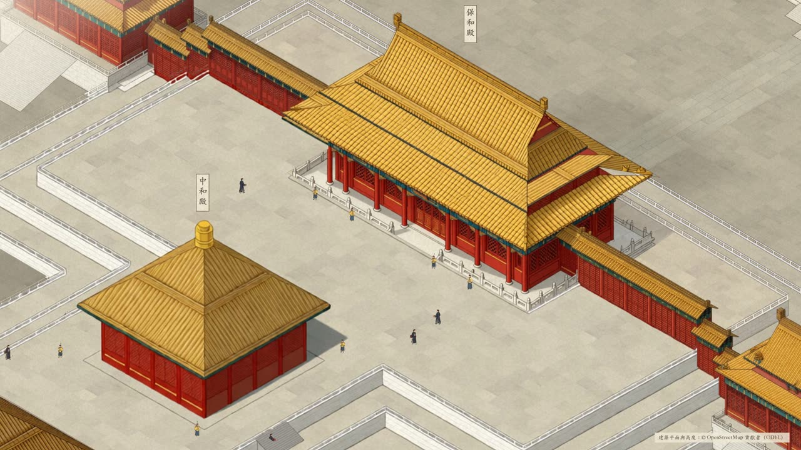 <br> **中和殿 · 保和殿**：三大殿收束 |

### 流水线的两张"工作照"

| | |
|---|---|
| 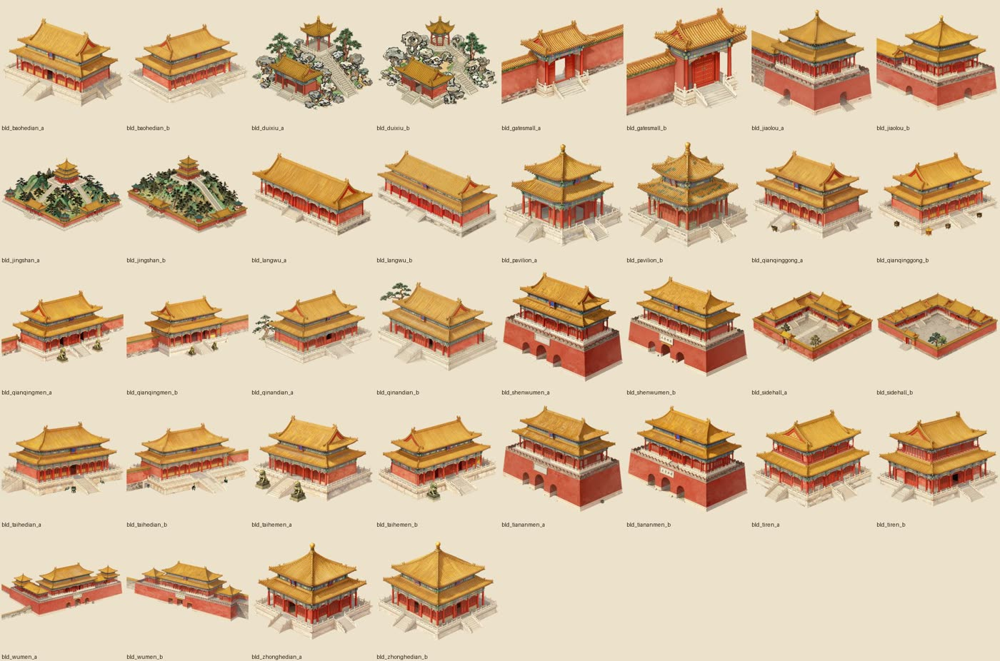 | 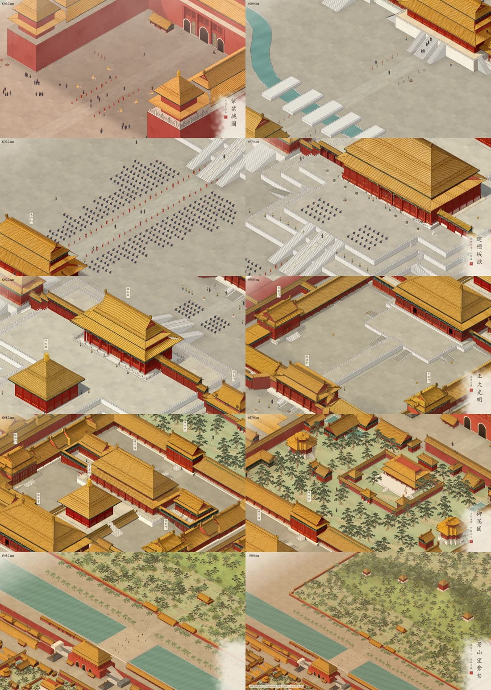 |
| `contact_sheet.py`：每批新图必过的对照表（风格统一、朝向登记、无抠图残渣、无文字、体量合理） | `frame_grid.py`：成片抽帧拼图，验收时逐格核对时间轴 |

## 关联项目

### [qingming-scroll](https://github.com/xiwan/qingming-scroll) ·《清明上河图》卷轴互动版

**在线体验：<https://xiwan.github.io/qingming-scroll/>**

把上面这部《清明上河图》成片做成网页：**上下滑动 = 左右展卷**，滚动位置就是播放时刻——停下画面就停，
往回滚就倒着走，快慢进退由观众自己掌控；也可以一键自动展卷。

- 全卷缩略条：点哪跳哪，按住拖动快速翻卷；段落、昼夜天色、三首题诗都有标记
- 背景音乐《汴河画卷》两首循环播放，环境音跟着滚动速度响起
- 纯静态页面，推到 main 后由 GitHub Actions 自动发布到 GitHub Pages

---

## 核心思路

1. **时间就是空间**。镜头每秒走固定距离，所以"某样东西几秒出现、在画面里停几秒"由它在长卷上的位置决定。
   功能团、高潮、题诗、昼夜、音效，全部落在同一条时间轴上。
2. **疏密与聚团来自原作的空间逻辑**，不是随机撒点。先弄清那个社会怎么用空间（城乡梯度、交通节点、
   同业相聚、官署寺观的形制），再排功能团。
3. **我们看得到画面、听不到声音**。画面靠抽帧、统计、跳帧检查验收；声音只能靠分类模型打标签核对——
   交付时要说清哪些验证过、哪些没法验证。

## 九步流程（每步都有"过不去就别往下做"的门槛）

| 步 | 做什么 | 门槛 | 文档 |
|---|---|---|---|
| 1 | 读原作，建时间轴表 | 每个功能团 ≥8 秒；高潮在 55%–75%；题诗不压名场面 | [source-analysis.md](references/source-analysis.md) |
| 2 | 立风格，生产精灵素材 | 每批新图过对照表，不合格重出、不在引擎里将就 | [assets.md](references/assets.md) |
| 3 | 搭引擎骨架 | `preview` 能出任意秒数的帧；setup 打印各层数量 | [engine.md](references/engine.md) |
| 4 | 布局：功能团、疏密、选图 | 每 10 秒房屋数贴近目标；**素材里每张建筑图都出场** | [layout.md](references/layout.md) |
| 5 | 让行人车马船动起来 | 船过弯在三张朝向图之间硬切、按船底对齐 | [motion.md](references/motion.md) |
| 6 | 卷上的字（题诗、落款、钤印） | 繁体楷书竖排右起、逐字晕墨、印章最后按上 | [text.md](references/text.md) |
| 7 | 光：昼夜晨昏与万家灯火 | 发光层按画家顺序一次算好；灯笼按连通块筛 | [lighting.md](references/lighting.md) |
| 8 | 声音：环境声 + 定点音效 | 没有窗口被标成配乐/雷声/静音；约 −17 LUFS、真峰值 < −0.5 dBFS | [audio.md](references/audio.md) |
| 9 | 验收与交付 | 统计 → 抽帧 → 全片 → 跳变检查 0 离群 → 响度 → 回归清单 | [qa.md](references/qa.md) |

GPU 机、SSM 隧道、显存切换与成本控制见 [infra.md](references/infra.md)。

## 出问题先查哪

| 症状 | 先看 |
|---|---|
| 船过弯怪、叠影、换图跳一下 | motion.md §2 |
| 房子像复制粘贴 / 某张图从没出现 | layout.md §3–4 |
| 太密太匀、没有"团"的感觉 | layout.md §1–2，source-analysis.md §2 |
| 路口、拐角、石板街拼接生硬 | engine.md §3 |
| 题诗看不清、没和雾衬对齐、夜里被盖住 | text.md §3、§5 |
| 夜里红柱子发光 / 灯火太均匀 | lighting.md §3、§2 |
| 改了布局后某些东西消失 | qa.md §3 回归清单，engine.md §2 随机数流 |
| 音效出成配乐 / 雷声 / 没声 | audio.md §4 |
| 远端命令失败、ComfyUI 连不上 | infra.md §2–3 |

完整的"症状 → 原因 → 处理"表在 [qa.md](references/qa.md) §2。

## 安装

`SKILL.md` 用的是 [Agent Skills](https://agentskills.io) 开放标准（frontmatter 只有 `name` + `description`），
所以不绑定任何一家工具——放到对应目录就能被自动发现。

### Claude Code

```bash
# 个人级：所有项目都可用
git clone https://github.com/xiwan/scroll-painting-animation.git \
  ~/.claude/skills/scroll-painting-animation

# 或项目级：提交进仓库，团队共享
git clone https://github.com/xiwan/scroll-painting-animation.git \
  .claude/skills/scroll-painting-animation
```

装好后 `/skills` 里能看到它。两种用法：

- **让 Claude 自动加载**——说「把《千里江山图》做成横向长卷动画」这类话，匹配到 frontmatter 的 description 就会加载
- **显式调用**——输入 `/scroll-painting-animation`

### Kiro

```bash
git clone https://github.com/xiwan/scroll-painting-animation.git \
  ~/.kiro/skills/scroll-painting-animation
```

同样靠 description 触发，或在对话里用 `#` 手动引用。

### 其他 agent（Codex CLI / Cursor / Gemini CLI / Windsurf …）

这些工具对 skill 的发现机制各不相同，但内容是纯 markdown，最省事的办法是 clone 到任意位置，
然后在项目的 `AGENTS.md` / `CLAUDE.md` / 规则文件里加一行指路：

```markdown
做长卷/卷轴动画类任务时，先读 <path>/SKILL.md，按里面的九步流程和门槛执行。
```

### 只当文档库读

不装也行：`SKILL.md` 是入口（流程 + 门槛 + 文件索引），`references/` 下 10 篇是每步的细节，
`scripts/` 可以直接 `python scripts/scroll_demo.py render` 跑起来，不依赖任何 agent。

## 快速开始

```bash
python -m pip install numpy pillow imageio-ffmpeg       # 系统自带的 python3 通常没有 numpy

python scripts/scroll_demo.py stats                     # 看功能团与选图是否合理（不需要字体）
python scripts/scroll_demo.py preview 2 7.6 10 12.6 --out demo_frames   # 白天 / 入夜 / 夜 / 黎明 各一帧
python scripts/scroll_demo.py render --out demo.mp4                     # 14 秒小样（约 10 秒出完）
python scripts/popcheck.py demo.mp4 --skip 20                           # 跳帧检查，应为 0 离群
```

`scroll_demo.py` 不需要任何图片素材就能跑通，所有层（底图、精灵、行人、船、题字、昼夜、发光）都在里面，
新项目从它开始、按 `engine.md` 的层次逐步替换。

依赖：Python 3.10+、numpy、Pillow、imageio-ffmpeg；**出画面还需要一个 CJK 字体**——
macOS 自带楷体，Windows 自带 simkai，Linux 要装（`apt install fonts-noto-cjk` /
`dnf install google-noto-sans-cjk-fonts`），也可以用 `SCROLLKIT_FONT=/path/to/font.ttf` 指定。
GPU 部分（ComfyUI 出精灵、MMAudio 出音效）在远端机器上跑，见 `infra.md`；第 3–7、9 步纯本机，不需要 GPU。

## 安全须知

这个 skill 会让 agent 在 GPU 机上执行命令、读外部 JSON 配置、跑 ComfyUI 工作流。四条硬规则：

1. **配置文件和 workflow JSON 等同代码**。`sfx_config.json` 的 `remote.*` 路径会进远端 shell，
   ComfyUI 的 `/prompt` 默认无鉴权、工作流能加载任意权重和自定义节点。脚本对配置做了白名单校验
   （远端路径必须绝对、无空格、无 shell 元字符、至少两级；事件名只许 `[A-Za-z0-9_-]`；
   拉回的文件必须落在 `out_dir` 内），但**不要跑来源不明的配置或工作流**。
2. **`ssm_run.sh` 在远端以 root 执行任意命令**（AWS SSM `AWS-RunShellScript`）。执行前会回显调用者身份
   和命令并要求确认；被脚本/agent 非交互调用时必须显式 `SSM_RUN_YES=1`，否则拒绝执行。
   GPU 机当一次性实例用：最小权限 instance profile、不放长期凭据、用完就停。
3. **远端输出会进 agent 上下文**。不要在远端跑会回显凭据的命令；脚本回显远端日志时会对
   `AKIA…`/`token=`/`secret=` 做脱敏，但别指望它兜住一切。
4. **网络目标默认只允许回环地址**。`comfy_client.py --host` 和 `remote.comfy` 指向非本机地址时直接拒绝
   （本地文件、成片片段会被上传过去）；跨机请用 SSM/SSH 端口转发，确实要直连才设
   `COMFY_ALLOW_REMOTE_HOST=1` / `SFX_ALLOW_REMOTE_HOST=1`。

本仓库不含模型权重、素材库和成片，也不会把你的代码或数据发往第三方。

## 换题材要注意什么

方法论（九步、门槛、时间轴表）是通用的；`scrollkit` 里有几处是为中式题材写的，换题材要动：

| 情况 | 要改什么 |
|---|---|
| 片长不是 180 秒 | `DayNight` 默认是**绝对秒数**，做短片不传参会永远不入夜 → 用 `DayNight.for_duration(总秒数)` |
| 镜头速度不是 85.7 单位/秒 | `DistrictField(edge=420, warp=260)`、`SpritePicker(rep_r=360)` 要按秒换算（`edge ≈ 4 × speed / cos30`） |
| 非中式光源 | `lantern_mask` 的颜色判据默认认红灯笼 → 传 `color=LAMP_WARM`（火把/壁灯）或 `LAMP_WHITE`（路灯/窗光） |
| 非中文题字 | `InkItem.row()` 横排代替 `column()`；`draw_seal`（朱文方印）整体换掉 |
| 山水长卷、室内叙事 | **引擎没有地形也没有墙体剖切**，这是重写级工作，不是改配置 |

详见 [source-analysis.md §5](references/source-analysis.md)（迁移清单）。字体在非 macOS 平台的坑见
[text.md §0](references/text.md)：找不到 CJK 字体会直接报错，不会静默把题诗画成空白。

## 仓库结构

```
SKILL.md                      入口：流程、门槛、文件索引、协作习惯
references/                   九步 + 基础设施的细节文档（10 篇）
scripts/
  scrollkit.py                可复用零件：Iso/Camera、DistrictField、SpritePicker、InkItem、DayNight、lantern_mask
  scroll_demo.py              最小可运行骨架（stats / preview / render）
  comfy_client.py             ComfyUI 提交/等待/拉回/合成透明精灵/上传/释放显存
  contact_sheet.py            素材对照表
  tex_tile.py                 无缝贴图（bond/grid/soft/wrapx）
  frame_grid.py               成片抽帧拼图、跟拍条
  popcheck.py                 逐帧跳变检查
  sfx_mmaudio.py              配置驱动的音效流水线（plan/cut/run/tag/search/events/fetch/mix/auto）
  ssm_run.sh                  经 AWS SSM 在 GPU 机上执行命令（不开 22 端口）
assets/
  districts.qingming.json     北宋都城的功能团、档案、用途组、亲和度、地标时间轴
  prompts.qingming.json       73 条精灵提示词 + 风格常量 + 编辑提示词 + 贴图提示词
  sfx_config.example.json     音效配置样例（场景、修正、标签、事件）
docs/images/                  README 里的预览图
```

## 说明与致谢

- 预览图是本方法论产出的**原创渲染帧**，不是原画扫描件；《清明上河图》《紫禁城》作为题材与空间参考。
- 《紫禁城》案例的建筑平面与高度来自 **[OpenStreetMap](https://www.openstreetmap.org/copyright) 贡献者（ODbL）**。
- 素材由 ComfyUI 上的开源模型生成（Z-Image Turbo、Qwen-Image-Edit、BiRefNet 等）；
  音效由 **MMAudio** 生成，其权重为**非商用**许可——商用前请自行替换音源并核对许可。
- 本仓库只含方法论、脚本与配置，**不含模型权重、素材图库和成片**。

## 许可

代码与文档以 [MIT](LICENSE) 许可发布。预览图版权归作者所有，可在署名本仓库的前提下引用。
